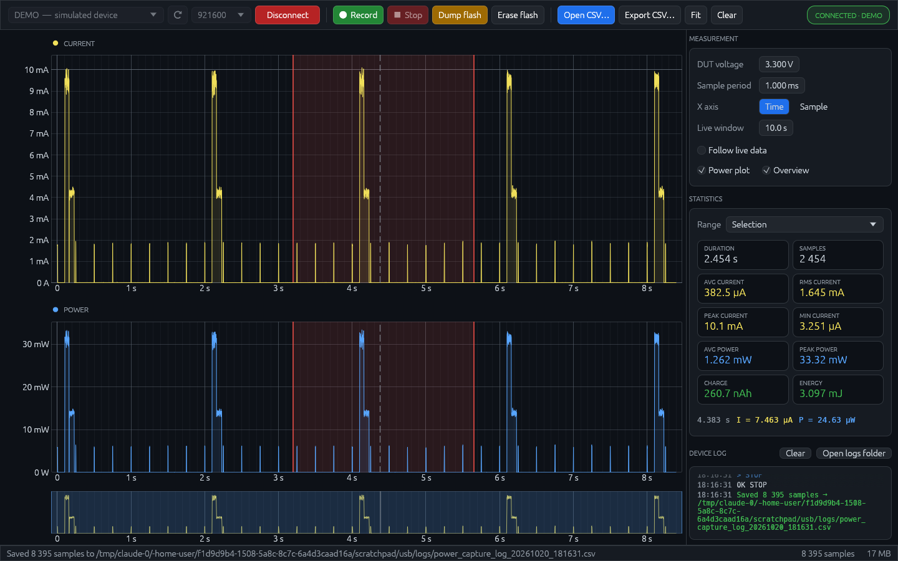

# Analizator — current & power analyzer GUI

Desktop app for capturing and analysing current measurements from the Analizator board over a serial port. Written in Rust ([egui](https://github.com/emilk/egui) + [egui_plot](https://github.com/emilk/egui_plot)); compiles to a single executable for Linux or Windows with nothing else to install.



## Download

| File | For |
|---|---|
| **[analizator-linux-x86_64.tar.gz](https://github.com/PoGo430/diploma-gui2-rust/raw/main/download/analizator-linux-x86_64.tar.gz)** | Normal PCs and laptops (64-bit Intel/AMD) |
| [analizator-linux-aarch64.tar.gz](https://github.com/PoGo430/diploma-gui2-rust/raw/main/download/analizator-linux-aarch64.tar.gz) | Raspberry Pi 4/5 with 64-bit OS |
| **[analizator-windows-x86_64.zip](https://github.com/PoGo430/diploma-gui2-rust/raw/main/download/analizator-windows-x86_64.zip)** | Windows 10/11 (64-bit) |

**Windows:** extract the zip and double-click `Analizator.exe`. The first time, Windows may say "Windows protected your PC" because the program isn't signed: click *More info → Run anyway*. The board appears as a COM port.

**Linux:** runs on any 64-bit Linux with glibc 2.27+ (Ubuntu 18.04, Debian 10, Fedora 28 or newer); nothing else to install.

```sh
tar xzf analizator-linux-x86_64.tar.gz
cd analizator-linux-x86_64
./install.sh        # adds a menu entry and desktop icon (optional)
./analizator        # or just double-click it
```

If connecting fails with "Permission denied", run `sudo usermod -aG dialout $USER` and log out and back in (`install.sh` offers to do this). No hardware? Pick **DEMO — simulated device** in the port list.

## Features

- Live capture with current and power plots plus an overview strip for navigating long recordings
- Min/max ("peak") decimation, so short current spikes stay visible at any zoom level; stays smooth with tens of millions of samples
- Statistics for the whole capture, a selection, or the visible window: duration, avg/RMS/peak/min current, avg/peak power, charge, energy
- Display filters: **moving average**, **median** (removes glitches, keeps edges) and **first-order low-pass** (RC-like), with the raw signal shown faintly behind; statistics can use raw or filtered data
- **Battery life estimate** from the average current, and a **sleep / active breakdown** (time share, average current and share of charge below/above a threshold)
- **Markers with labels**: press M or right-click a plot; drag to move; "➡" selects the range between two markers; saved in the capture file
- Hover readout of time, current and power at the cursor
- Flash dump / erase, auto-save of every capture to CSV, CSV import and export
- Built-in **DEMO** device for trying the app without hardware
- **Auto-reconnect**: if the board is unplugged, the recording so far is saved and the app reconnects by itself when it comes back
- Counter of corrupted serial frames (missing start/end marker or bad values) in the status bar
- Settings are remembered between runs

## Serial protocol

| Direction | Format |
|---|---|
| Board → PC | `$DB<v1>,<v2>,...,<vN>$DE\n`: current samples in µA. Any other line is shown in the device log. |
| PC → board | `START`, `STOP`, `DUMP`, `ERASE` (newline terminated) |

### Capture file format

Plain-text CSV. Settings that are the same for the whole capture are stored once at the top, then one current reading (µA) per line, exactly as received from the board:

```
# Analizator capture
# voltage_V=3.3
# sample_period_ms=1
# start_index=0
# saved=2026-10-20 18:37:27
# marker=1500,radio TX
Current_uA
0
1750.435
1775.779
```

- `# marker=<sample index>,<label>` lines hold the markers (optional).
- Sample *n* was taken at `(start_index + n) × sample_period_ms`; power is `current × voltage_V`.
- Files exported while a filter is active have a second column, `Current_filtered_uA`. Auto-saved recordings are always raw.
- If the samples are not evenly spaced (e.g. an imported file with gaps), an `Index` column is written first.
- Older files with `Index,Current_uA,Voltage_V,Power_uW` on every line still open.
- In Python: `pandas.read_csv(path, comment="#")`.

## Controls

| Action | Input |
|---|---|
| Zoom | Mouse wheel (around the pointer) |
| Pan | Drag |
| Fit all data | Double-click, or Ctrl+F |
| Make selection | Shift + drag (then drag edges to resize, middle to move) |
| Add marker | M (at the mouse; while recording without the mouse on a plot: at the newest sample), or right-click → Add marker |
| Move / delete marker | Drag its line / right-click it → Delete, or 🗙 in the Markers panel |
| Jump around | Click/drag in the overview strip |
| Record / stop | Ctrl+R |
| Open / export CSV | Ctrl+O / Ctrl+S |
| Toggle selection stats | Ctrl+E |

## Building

Install Rust from <https://rustup.rs>, then:

```sh
cargo build --release
./target/release/analizator            # optionally: ./target/release/analizator capture.csv
cargo test                             # unit tests
```

### Portable build for older Linux distributions

A normal build links against the build machine's glibc. To produce a binary that runs on any distribution with glibc 2.27+ (Ubuntu 18.04 and newer), use [cargo-zigbuild](https://github.com/rust-cross/cargo-zigbuild):

```sh
pip install ziglang cargo-zigbuild
cargo zigbuild --release --target x86_64-unknown-linux-gnu.2.27
# Raspberry Pi 4/5 (64-bit OS):
rustup target add aarch64-unknown-linux-gnu
cargo zigbuild --release --target aarch64-unknown-linux-gnu.2.27
```

### Windows build (cross-compiled from Linux)

```sh
sudo apt install mingw-w64
rustup target add x86_64-pc-windows-gnu
cargo build --release --target x86_64-pc-windows-gnu
# -> target/x86_64-pc-windows-gnu/release/analizator.exe (icon embedded by build.rs)
```

On Windows itself, `cargo build --release` works too.

### Packaging

Put the binary next to `packaging/install.sh`, `packaging/README.txt` and `assets/analizator.png`, then archive it with `tar czf` (this keeps the executable bit). Users run `./install.sh` to add a menu entry and desktop icon; `./install.sh --remove` uninstalls.

## Serial port permission (Linux)

Opening a serial port requires membership in the `dialout` group (`uucp` on Arch):

```sh
sudo usermod -aG dialout $USER   # then log out and back in
```

## Source layout

| File | Purpose |
|---|---|
| `src/main.rs` | Window setup |
| `src/app.rs` | User interface, plotting, capture logic |
| `src/data.rs` | Sample storage with per-256-sample min/max/sum blocks (fast drawing and statistics) |
| `src/serial.rs` | Port listing, reader thread, frame parser, DEMO board |
| `src/filter.rs` | Moving average, median and low-pass filters |
| `src/csvio.rs` | CSV load/save |
| `src/fmt.rs` | SI-prefix number formatting |

## Releases

Ready-to-run Linux packages are on the [Releases](../../releases) page. To publish a new version, push a tag:

```sh
git tag v2.0.1
git push origin v2.0.1
```

The [release workflow](.github/workflows/release.yml) then tests, builds the Linux (x86_64, arm64) and Windows packages, and publishes the release automatically.

## Testing without the board

Besides the built-in DEMO device, any serial device path can be added to the port list with `ANALIZATOR_EXTRA_PORTS` (colon-separated), e.g. a virtual port pair made with socat:

```sh
socat pty,raw,echo=0,link=/tmp/ttyV0 pty,raw,echo=0,link=/tmp/ttyV1 &
ANALIZATOR_EXTRA_PORTS=/tmp/ttyV0 ./analizator    # a script on /tmp/ttyV1 plays the board
```
